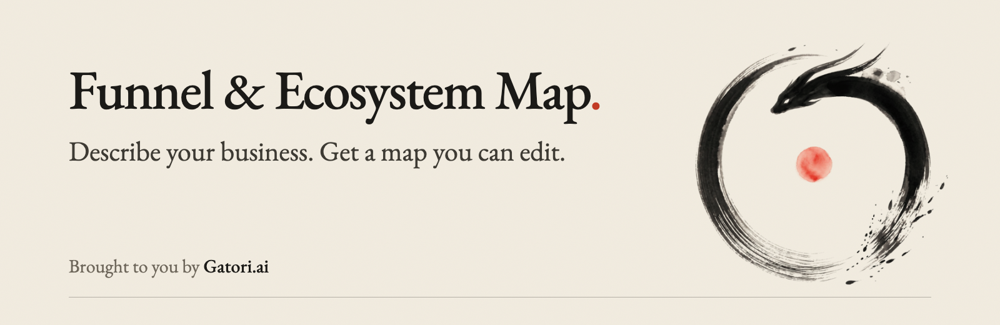
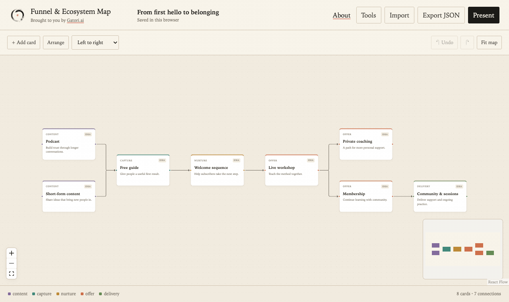

<p align="center">
  <picture>
    <source media="(prefers-color-scheme: dark)" srcset="assets/banner-night.png">
    
  </picture>
</p>

Describe a funnel or a whole business in plain words and get a map of it: the content, the offers, the people and systems, and the paths that connect them. Every card and every arrow stays editable. Ask for a change in words, or make it by hand.

<p align="center"></p>

| If you are | Start with |
|---|---|
| A person who wants to try it | [Run it](#run-it), or the About link inside the app |
| An AI agent asked to draw or change someone's map | [AGENTS.md](AGENTS.md) |
| An AI agent asked to change this project | [AGENTS.md, "Working on the code"](AGENTS.md#working-on-the-code) |

## What it does

- **Maps from a description.** Write what the business does and choose Create map. Each card gets a category (audience, content, capture, nurture, offer, delivery, team, system), a description, an owner and a status (idea, building, live).
- **Changes from a sentence.** "Add a referral loop after the workshop." Cards you renamed or assigned by hand keep your edits.
- **Edits by hand.** Click a card to change it. Drag from one card to another to connect them. Click an arrow to label or delete it.
- **Layout.** Arrange lays the map out left to right or top to bottom.
- **Undo and redo**, including changes the AI made.
- **Present.** Hides the editing panels for showing the map to someone.
- **Saved maps.** Named snapshots in the browser, plus JSON export and import for backups and for moving a map to another device.

## Run it

You need Node 20 or later.

```
npm install
npm run dev
```

This serves the full editor on your computer. The editor runs locally. The built-in AI needs the Netlify functions, so use a deployed site for the connection described below.

### Connect your own OpenAI key

On a deployed copy, open **Tools**, expand **Connect your AI**, and paste an [OpenAI API key](https://platform.openai.com/api-keys). Press **Connect**, then describe your map. OpenAI API billing is separate from ChatGPT subscriptions. Your key stays in the tab’s memory until you reload or disconnect; each request sends it to the site’s server and OpenAI. Only enter a key on a site you trust. Your prompt and current map are also sent to OpenAI. This is an OpenAI API connection; use the assistant workflow below for Claude, ChatGPT or other tools.

### Deploy your own copy

1. Create a Netlify site. Build with `npm run build`, then publish this folder to the site with the Netlify CLI (production, no build step, naming your site ID).
2. Set two function environment variables on the site:
   - `MAP_ACCESS_SECRET`: a long random string. It signs the browser session that is allowed to call the AI.
   - `MAP_AI_MODEL`: the model name. The default is `gpt-4.1-mini`.
3. Give the functions a model provider. With Netlify AI Gateway enabled, the OpenAI SDK picks up its credentials with no further setup. Without it, set `OPENAI_API_KEY` on the site.
4. Copy `.access.example.json` to `.access.json` and fill in your site address and the same secret. This file stays on your computer; git ignores it.
5. Run `npm run unlock`. It opens your site in Chrome with a link that is valid for five minutes and gives that browser a 30-day session.

The session cookie is sent over HTTPS only, so test unlocking on your deployed site. The access scheme suits one person or a small trusted group. Review rate limits and billing before you share your site's address.

## Use it with your own AI assistant

The built-in AI is optional. ChatGPT, Claude, Codex or any other assistant can write the map as a file:

1. Give your assistant the prompt below and save its answer as a `.json` file.
2. In the canvas, press **Import** and choose that file.
3. To revise a map, press **Export JSON**, give the file and your changes to your assistant, and import the result.

Prompt to copy:

> Create a business map as JSON for Funnel & Ecosystem Map. Return an object with `title`, `nodes`, and `edges`. Each node needs `id`, `label`, `kind`, `description`, `owner`, and `status`. Kinds are audience, content, capture, nurture, offer, delivery, team, or system. Status is idea, building, or live. Use an empty string for an unknown owner. Node IDs may contain only letters, numbers, underscores, and hyphens. Each edge needs a unique `id`, `source`, `target`, and `label`; source and target must match node IDs. Use at most 60 nodes and 120 edges. Here is what I want to map: [describe your business].

An assistant that can read this folder gets the same instructions from [AGENTS.md](AGENTS.md).

## AI and privacy

- A personal key is held in tab memory and sent to the site’s server for each request; it is not saved by the app. A site-provided key stays in server environment variables.
- Anyone can use their own OpenAI key; a site-funded key requires a signed session. Everyone can edit by hand.
- Requests must come from the site itself. Each address gets five AI requests per minute.
- A description is limited to 6,000 characters and a map to 60 cards and 120 connections.
- The model's answer is checked against a fixed schema before it touches the map. Maps hold text only, and that text is never rendered as HTML.
- If a request fails, the current map is left as it was.

## Limits

- One person at a time. There are no accounts, no shared maps and no live collaboration.
- The current map and the snapshots live in one browser. Export JSON to keep a copy.
- The AI is sent the current map with each request. It does not see earlier requests, so name the card you mean.
- Each AI request uses your provider credits.

## Map format

Export JSON and "View map data" show the same model the AI works with:

```json
{
  "title": "From first hello to belonging",
  "nodes": [
    { "id": "guide", "label": "Free guide", "kind": "capture", "description": "Give people a useful first result.", "owner": "", "status": "idea" }
  ],
  "edges": [
    { "id": "e1", "source": "podcast", "target": "guide", "label": "" }
  ]
}
```

## Repository map

```
AGENTS.md              instructions for an AI agent (CLAUDE.md points to it)
src/main.jsx           the whole interface: canvas, cards, tools panel, inspector
src/graph.js           the starter map, category colors, layout, model conversion
src/style.css          styles, in the Gatori Ink palette
server/schema.js       the map's shape and its validation, shared by browser and server
server/auth.js         signed tickets and the session cookie
netlify/functions/     generate.js (the AI request), session.js (unlocking a browser)
scripts/unlock.mjs     opens your site with a short-lived signed link
public/                the about page, the mark, robots.txt
assets/                banners and the demo GIF; sources in assets/src/
LICENSE                MIT
netlify.toml           build settings, security headers, the content security policy
```

## License

MIT. See [LICENSE](LICENSE).

<p align="center">Brought to you by <a href="https://gatori.ai">Gatori.ai</a></p>
